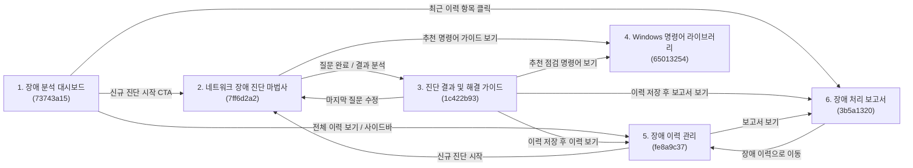

# NetDoctor — Design System, Stitch Specification & UI Parity Guide

본 문서는 **NetDoctor**의 실제 Stitch 디자인 프로젝트 정보, 통합 디자인 시스템(`Obsidian Telemetry`), 6개 화면 ID, 디자인 토큰, 사용자 화면 이동 흐름, 그리고 실제 React 구현과의 정합성 비교 결과를 기록합니다.

---

## 1. 실제 작업 순서 기록 (Chronological Work Order)

본 프로젝트는 다음 실제 순서로 수행되었습니다.

1. **1단계 — Multi-Agent 개발 전략 수립 및 초기 문서 작성**: 최초 Stitch MCP `list_projects` 조회 시 기존 `NetDoctor` 프로젝트가 존재하지 않아 기준 문서(`README.md`, `DESIGN.md`, `docs/DIAGNOSTIC_RULES.md`, `docs/AGENT_PLAN.md`)를 선행 작성함.
2. **2단계 — NetDoctor 기본 웹앱 구현 및 QA 검증 (`develop` 브랜치)**: Orchestrator + Agent A / B / C 병렬 개발 및 QA Agent 47개 테스트(`test`, `lint`, `tsc`, `build`) 통과 완료.
3. **3단계 — Stitch 디자인 보완 및 정합성 검증 (본 단계)**: 14주차 평가 기준(Stitch UI/UX 15점) 충족을 위해 **기본 웹앱 구현 이후** 실제 Stitch MCP로 `NetDoctor` 신규 프로젝트(`4784524362639964908`)를 생성하고, 실제 구현된 React 화면 및 `DESIGN.md`를 기준으로 통일된 디자인 시스템(`Obsidian Telemetry`) 하에 6개 핵심 화면을 생성·검증함. 이후 Stitch 디자인과 React 구현 화면 간 차이를 비교하여 CSS 토큰 및 모바일(390px) 상단 헤더를 보완하고 테스트·빌드 회귀 검증을 완료함.

> 기존 Stitch 프로젝트(`Travel-Planner-MVP`: `15535182799094676996`, `대학생 학습관리 웹앱`: `6562865603819829757`)는 일절 수정하지 않았습니다.

---

## 2. Stitch MCP 프로젝트 및 6개 화면 목록 (실제 조회 검증)

- **Stitch Project Resource**: `projects/4784524362639964908`
- **Stitch Project ID**: `4784524362639964908`
- **Project Title**: `NetDoctor` (`PROJECT_DESIGN`, `DESKTOP`, `PRIVATE`)
- **Design System Asset ID**: `assets/49c70fc97e7d4e3f91513c24cb22c92e` (`Obsidian Telemetry`)
- **검증 방법 및 사실 기록**:
  - `stitch.update_project`로 6개 `SCREEN_INSTANCE`와 1개 `DESIGN_SYSTEM_INSTANCE`를 사용자 흐름 순서(2행 × 3열, 각 1440px 기준)로 캔버스 배치함.
  - `stitch.get_project` 결과: **6개 `SCREEN_INSTANCE` 전체 등록 확인 완료**.
  - `stitch.list_screens` 호출 결과: Stitch MCP `list_screens` 응답 상한(페이지 파라미터 미제공, 최대 5건 반환)으로 1~5번 화면 5건 반환 확인, 6번 화면(`3b5a13204f0440ee96cca87bbda6b00b`)은 `stitch.get_screen` 및 `stitch.get_project.screenInstances`로 존재·완성 상태 교차 검증 완료.

| # | 화면명 | Stitch Screen ID | Resource Name | 해상도(생성) / 캔버스 배치 | 대응 React 화면 |
| :-: | :--- | :--- | :--- | :--- | :--- |
| 1 | **장애 분석 대시보드** | `73743a150fc3459fb2f8379f52474715` | `projects/4784524362639964908/screens/73743a150fc3459fb2f8379f52474715` | `2560×2048` / `(x:0, y:0)` | `src/features/dashboard/DashboardPage.tsx` |
| 2 | **네트워크 장애 진단 마법사** | `7ff6d2a29222440e93b9d568f6e9a711` | `projects/4784524362639964908/screens/7ff6d2a29222440e93b9d568f6e9a711` | `2560×2292` / `(x:1600, y:0)` | `src/features/diagnosis/DiagnosisPage.tsx` (Step 1~2) |
| 3 | **진단 결과 및 해결 가이드** | `1c422b93aac146ae8004e94d953eeddb` | `projects/4784524362639964908/screens/1c422b93aac146ae8004e94d953eeddb` | `2560×4326` / `(x:3200, y:0)` | `src/features/diagnosis/DiagnosisPage.tsx` (Step 3) |
| 4 | **Windows 명령어 라이브러리** | `6501325405964537b53caa36c695b64f` | `projects/4784524362639964908/screens/6501325405964537b53caa36c695b64f` | `2560×3820` / `(x:0, y:2150)` | `src/features/guide/GuidePage.tsx` |
| 5 | **장애 이력 관리** | `fe8a9c3721f44d0383485fd9bce8675e` | `projects/4784524362639964908/screens/fe8a9c3721f44d0383485fd9bce8675e` | `2560×3650` / `(x:1600, y:2150)` | `src/features/history/HistoryPage.tsx` |
| 6 | **장애 처리 보고서** | `3b5a13204f0440ee96cca87bbda6b00b` | `projects/4784524362639964908/screens/3b5a13204f0440ee96cca87bbda6b00b` | `2560×3292` / `(x:3200, y:2150)` | `src/features/report/ReportPage.tsx` |

---

## 3. 디자인 토큰 (`Obsidian Telemetry` ↔ `src/styles/tokens.css`)

### 3.1 컬러 시스템

| Token (`src/styles/tokens.css`) | Hex / Value | 용도 |
| :--- | :--- | :--- |
| `--nd-bg-canvas` | `#0B1220` | 메인 페이지 배경 캔버스 (Deep Dark Navy) |
| `--nd-bg-sidebar` | `#070D1A` | 좌측 고정 사이드바 및 모바일 헤더 배경 |
| `--nd-bg-surface` | `#111B2E` | 기본 카드·패널·테이블 표면 |
| `--nd-bg-surface-elevated` | `#162238` | 모달·드롭다운·상승 표면 |
| `--nd-bg-terminal` | `#060B14` | Windows 명령어 코드 블록 및 보고서 미리보기 배경 |
| `--nd-border-structural` | `#1E293B` | 카드·헤더·입력 필드 1px 구조 경계선 |
| `--nd-cyan-primary` | `#06B6D4` | 주요 CTA 버튼, 활성 메뉴, 브랜드 핵심 포인트 |
| `--nd-cyan-bright` | `#22D3EE` | 호버 강조, 포커스 링, 코드/지표 하이라이트 |
| `--nd-cyan-glow` | `0 0 10px rgba(6, 182, 212, 0.25)` | 시안 포커스·활성 요소 글로우 |
| `--nd-text-primary` | `#F1F5F9` | 고대비 주요 제목 및 수치 |
| `--nd-text-secondary` | `#CBD5E1` | 본문 설명 및 보조 라벨 |
| `--nd-text-muted` | `#94A3B8` | 메타 정보, 타임스탬프, 플레이스홀더 |
| `--nd-status-success` | `#10B981` | 해결됨(Resolved), 정상 출력 해석 |
| `--nd-status-warning` | `#F59E0B` | 진행 중(In Progress), 주의/근거 부족 안내 |
| `--nd-status-danger` | `#F43F5E` | 미해결/심각(Critical), 오류 출력, 삭제 경고 |

### 3.2 타이포그래피 및 반응형 뷰포트 규격

- **UI Sans**: `'Pretendard', 'Inter', 'Noto Sans', -apple-system, BlinkMacSystemFont, 'Segoe UI', sans-serif`
- **Monospace**: `'JetBrains Mono', 'Fira Code', 'Consolas', monospace` (명령어, IP/포트, 타임스탬프, KPI 숫자)
- **데스크톱 중심 (1440px)**: 좌측 고정 사이드바 `288px` (`lg:w-72`) + 우측 메인 워크스페이스(`max-w-7xl`), 12컬럼/5컬럼 KPI 그리드 및 2단 분할 레이아웃
- **모바일 대응 (390px)**: 상단 고정 헤더(`AppLayout`) + 슬라이드오버 내비게이션 드로어 + 반응형 상단 화면 제목 바 + 단일 컬럼 카드 스택 및 터치 친화적 버튼

---

## 4. 사용자 화면 이동 흐름 (Screen Navigation Flow)

### 4.1 Stitch 프로토타입 연결 지원 여부 (사실 기록)
- Stitch MCP 제공 도구(`update_project`, `update_screen` 등) 스키마 점검 결과, **인터랙티브 프로토타입 엣지/클릭 링크를 생성하는 전용 RPC는 제공되지 않습니다**.
- 대신 `stitch.update_project`의 `screenInstances` 좌표를 사용하여 1행(`1. 대시보드 → 2. 진단 마법사 → 3. 진단 결과`), 2행(`4. 명령어 가이드 ↔ 5. 장애 이력 → 6. 장애 보고서`) 흐름 구조로 캔버스를 정렬 배치했으며, 실제 화면 전환은 React [src/App.tsx](./src/App.tsx)에 모두 구현되어 있습니다.

### 4.2 화면 간 이동 흐름도

### 4.3 글로벌 내비게이션 (전 화면 공통)
- 데스크톱 좌측 사이드바 및 모바일 드로어에서 5개 최상위 경로(`대시보드`, `장애 진단`, `명령어 가이드`, `장애 이력`, `장애 보고서`)와 `신규 진단 시작` CTA로 언제든 즉시 이동할 수 있습니다.

---

## 5. Stitch 디자인 vs 실제 React 구현 비교 및 보완 내역

| 비교 항목 | Stitch 생성 화면 (`Obsidian Telemetry`) | 실제 React 구현 | 조치 / 판단 |
| :--- | :--- | :--- | :--- |
| **컬러·다크 네이비/시안 테마** | `#0B1220`, `#070D1A`, `#111B2E`, `#1E293B`, `#06B6D4`, `#22D3EE` | 동일 팔레트 적용 | `src/styles/tokens.css`에 `--nd-border-structural: #1e293b`, `--nd-cyan-glow`, `--nd-danger-glow` 토큰 추가 동기화 |
| **모바일 390px 화면 헤더** | 모바일 단일 컬럼에서 현재 화면 맥락 표시 | 기존 `AppLayout`의 상단 제목 바가 `hidden lg:flex`로 모바일에서 숨겨져 있었음 | `src/layouts/AppLayout.tsx` 상단 제목/부제 바를 모바일(390px)에서도 깔끔하게 표시되도록 반응형 보완 |
| **실시간 미측정 수치 / 사내 주소** | AI 생성 목업 일부에 예시용 `RTT 14ms`, `corp.local`, `10.0.0.10` 텍스트 포함 | **보안·정확성 원칙에 따라 전면 배제** (`example.com`, `192.0.2.1`, `8.8.8.8`, `127.0.0.1` 사용, 미측정 수치 미표시) | **의도적 유지 (보안 우선)**: React 구현이 프로젝트 보안 요구사항을 엄격히 준수하도록 유지 |
| **보고서 파일 다운로드 / 진단 비교** | 로드맵 배너만 표시, 다운로드 버튼 배제 | 동일하게 기본 버전에서 배제 (`feature/report-download`, `feature/diagnosis-comparison` 예정) | **완전 일치** |

---

## 6. 공통 컴포넌트 및 접근성·보안 원칙

- **공통 컴포넌트 8종 (`src/components/`)**: `Button`, `Badge`, `Card`, `Modal`, `SearchInput`, `CopyCodeBlock`, `AlertBanner`, `EmptyState`
- **접근성(WCAG 2.1 AA)**: 키보드 포커스 링(`#22D3EE`), `Escape` 모달 닫기 및 포커스 복원, 클립보드 복사 `aria-live="polite"`, 색상+아이콘+텍스트 병행 상태 표기
- **보안 원칙**: `dangerouslySetInnerHTML` 전면 금지, 공백·글자 수·인증정보 입력 차단, LocalStorage 스키마 검증, 방화벽 해제 유도 및 자동 네트워크 설정 변경 금지

---

## 7. GitHub MCP 저장소 접근 확인 기록

- **호출 API**: `github.get_me`, `github.search_repositories(query="user:sujung0712 NetDoctor")`, `github.list_branches(owner="sujung0712", repo="NetDoctor")`
- **확인 결과**:
  - 인증 계정: `sujung0712` (`https://github.com/sujung0712`)
  - 대상 저장소: `sujung0712/NetDoctor` (`id: 1472700417`, Public, `https://github.com/sujung0712/NetDoctor`, 기본 브랜치 `main`) — **정상 접근 가능**
  - 현재 원격 브랜치 수: `0` (빈 저장소 상태, 요청에 따라 GitHub Push 및 Vercel 배포는 미수행)
