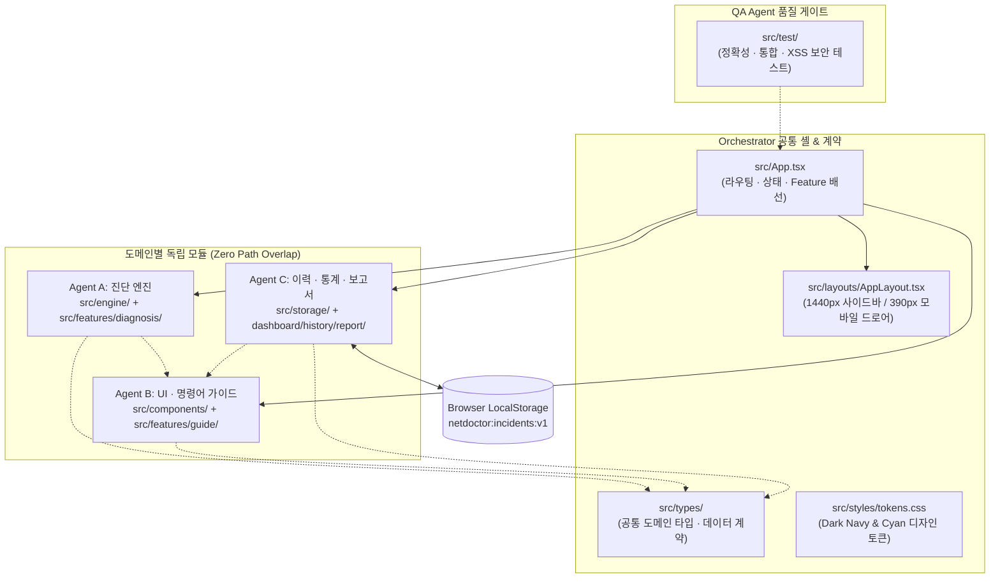

# NetDoctor — IT 네트워크 장애 진단 & 지원 워크스페이스

> **14주차 My Agentic App 프로젝트**  
> 규칙 기반 네트워크 장애 진단 엔진, Microsoft 공식 문서 기반 Windows 진단 명령어 가이드, LocalStorage 장애 이력 관리·통계 대시보드 및 표준 보고서 생성을 통합 제공하는 IT 기술지원 SaaS 웹 애플리케이션입니다.

---

## 1. 서비스 소개

**NetDoctor**는 네트워크 장애 발생 시 사용자가 증상을 선택하고 단계별 질문에 `예 / 아니오 / 모름`으로 응답하면, 결정론적(Deterministic) 규칙 기반 엔진이 유력한 원인 후보, 판단 근거, 추천 점검 순서, 안전한 해결 방법 및 추가 확인 항목을 도출해 주는 클라이언트 사이드 웹 서비스입니다.

진단 결과는 브라우저 LocalStorage 기반 장애 이력으로 즉시 저장할 수 있으며, 대시보드에서 저장된 이력 기준 통계를 시각화하고, 기술지원 표준 형식의 장애 처리 보고서(Markdown / 일반 텍스트)를 생성해 복사할 수 있습니다.

---

## 2. 대상 사용자

- **사내 IT 헬프데스크 / 기술지원 엔지니어**: 1차 네트워크 장애 문진 표준화, 점검 절차 안내, 장애 이력·MTTR 추적 및 보고서 작성
- **원격/재택근무자 및 일반 PC 사용자**: 인터넷 끊김, VPN 접속 실패, DNS 오류, 속도 저하 발생 시 네트워크 설정을 임의로 건드리지 않고 안전하게 1차 자가 점검 수행
- **네트워크 학습자 및 운영 담당자**: Windows 표준 네트워크 진단 명령어(`ipconfig /all`, `ping`, `nslookup`, `tracert`, `Test-NetConnection`)의 실행 방법과 정상/주의/오류 출력 해석 학습

---

## 3. 핵심 기능

### 3.1 기본 버전 포함 기능 (현재 `develop` 구현 완료)
- **장애 분석 대시보드**: 실제 저장된 장애 이력 기반 KPI 5종(전체 장애 건수, 해결 건수, 미해결 건수, 해결률, 평균 처리 시간), Recharts 장애 유형별 분포 차트, 최근 장애 이력, 신규 진단 시작 CTA, `[샘플]` 명확 표기 샘플 데이터 불러오기/삭제
- **규칙 기반 장애 진단 마법사**: 5대 장애 유형(`인터넷 연결 불가`, `VPN 연결 실패`, `DNS 오류`, `네트워크 속도 저하`, `연결 끊김`), 동적 질문 분기(`예`/`아니오`/`모름`), 6대 결과 항목(가능한 원인 후보, 판단 근거, 사용자 입력 요약, 추천 점검 순서, 안전한 해결 방법, 추가 확인 사항), 근거 부족 시 원인 미확정 판정
- **Windows 명령어 라이브러리**: Microsoft Learn 공식 문서 기반 5종(`ipconfig /all`, `ping`, `nslookup`, `tracert`, `Test-NetConnection`) 검색·분류·원클릭 복사·실행 방법·출력 해석
- **장애 이력 관리**: 진단 결과 저장, 수동 등록/수정/삭제, 발생·해결 시각 및 처리 시간 자동 산출, 조치 내역 기록, 해결 여부 전환, 검색/필터, 새로고침 영속 유지
- **장애 처리 보고서**: 6대 필수 항목(장애 유형, 사용자 점검 결과, 가능한 원인 후보, 판단 근거, 조치 내역, 해결 상태) 포함 Markdown / 일반 텍스트 생성 및 클립보드 복사

### 3.2 추후 별도 Feature 브랜치 예정 기능 (기본 버전 미포함)
- `feature/report-download`: 장애 보고서 파일 다운로드 (`.md` / `.txt`)
- `feature/diagnosis-comparison`: 고급 진단 결과 비교 기능

---

## 4. 기술 스택

| 구분 | 기술 및 고정 버전 |
| :--- | :--- |
| **Runtime** | Node.js `>=20.0.0 <25.0.0` (Node 20 & 24 호환, 로컬 `v24.22.2` 검증) |
| **Frontend** | React `18.3.1`, TypeScript `5.6.3` (`strict: true`), Vite `5.4.11` |
| **Styling & UI** | Tailwind CSS `3.4.17`, Lucide React `0.469.0`, Recharts `2.15.0` |
| **Storage** | Browser `localStorage` (`netdoctor:incidents:v1`) + 런타임 스키마 검증 |
| **Test & Lint** | Vitest `2.1.8`, React Testing Library `16.1.0`, `@testing-library/jest-dom` `6.6.3`, `jsdom` `25.0.1`, ESLint `9.17.0` |
| **CI** | GitHub Actions (`.github/workflows/ci.yml`, `ubuntu-latest`, Node 20 & 24 매트릭스) |

---

## 5. 로컬 실행 방법

```bash
# 1. 저장소 클론 및 디렉터리 이동
git clone https://github.com/sujung0712/NetDoctor.git
cd NetDoctor

# 2. 의존성 설치 (package-lock.json 기반 재현 설치)
npm ci

# 3. 개발 서버 실행
npm run dev

# 4. 프로덕션 빌드 및 미리보기
npm run build
npm run preview
```

> 외부 API Key, `.env` 파일, 백엔드 서버 없이 브라우저만으로 즉시 실행됩니다.

---

## 6. 시스템 아키텍처



### 디렉터리 구조

```text
NetDoctor/
├── .github/workflows/ci.yml       # Node 20/24 GitHub Actions CI
├── docs/
│   ├── AGENT_PLAN.md              # Multi-Agent 개발 전략·소유권·데이터 계약
│   ├── DIAGNOSTIC_RULES.md        # 5대 장애 유형 규칙 기반 진단 명세
│   └── QA_REPORT.md               # 실제 테스트·보안 검사·미검증 항목 리포트
├── src/
│   ├── main.tsx / App.tsx         # [Orchestrator] 앱 진입점 및 통합 배선
│   ├── types/                     # [Orchestrator] 공통 TypeScript 계약
│   ├── styles/                    # [Orchestrator] Obsidian Telemetry 디자인 토큰
│   ├── layouts/                   # [Orchestrator] 반응형 App Shell
│   ├── engine/                    # [Agent A] 순수 TS 진단 엔진 및 단위 테스트
│   ├── components/                # [Agent B] 재사용 UI 컴포넌트 8종
│   ├── storage/                   # [Agent C] LocalStorage CRUD·검증·통계·보고서
│   ├── features/
│   │   ├── diagnosis/             # [Agent A] 대화형 진단 마법사 UI
│   │   ├── guide/                 # [Agent B] Windows 명령어 라이브러리 UI
│   │   ├── dashboard/             # [Agent C] KPI & Recharts 대시보드 UI
│   │   ├── history/               # [Agent C] 장애 이력 CRUD UI
│   │   └── report/                # [Agent C] 장애 처리 보고서 UI
│   └── test/                      # [QA Agent] 정확성·통합·XSS 보안 테스트
├── DESIGN.md                      # Stitch ID, 디자인 토큰, 화면 흐름, 정합성 기록
└── README.md
```

---

## 7. 규칙 기반 진단 엔진 설명

`src/engine/`은 React·DOM·LocalStorage에 의존하지 않는 **순수 TypeScript 결정론적 추론 엔진**으로 구현되었습니다([docs/DIAGNOSTIC_RULES.md](./docs/DIAGNOSTIC_RULES.md)).

- **지원 장애 유형 (5종)**: `NO_INTERNET` (인터넷 연결 불가), `VPN_FAILURE` (VPN 연결 실패), `DNS_ERROR` (DNS 오류), `SLOW_NETWORK` (네트워크 속도 저하), `INTERMITTENT_DROP` (연결 끊김)
- **동적 질문 분기 (`getInitialQuestion`, `getNextQuestion`)**: 모든 질문이 `예(yes)`, `아니오(no)`, `모름(unknown)`을 지원하며 이전 응답에 따라 후속 질문 경로가 실시간으로 변경됩니다.
- **동적 원인 추론 (`evaluateDiagnosis`)**: 고정된 문자열을 반환하지 않고 사용자의 실제 응답 조합에 따라 규칙 점수와 판단 근거(`evidence`), 추천 점검 순서(`recommendedCheckOrder`), 안전한 해결 방법(`safeResolutions`), 추가 확인 사항(`additionalChecksNeeded`)을 계산합니다.
- **근거 부족 시 원인 미확정 원칙**: `모름` 응답 비율이 50% 이상이거나, 최상위 후보 점수가 60점 미만이거나, 상위 1·2위 후보 간 점수 차이가 10점 이하로 경합할 경우 `isConclusive = false`로 판정하고 단일 원인을 확정하지 않습니다.

---

## 8. Multi-Agent 역할 분담

공통 TypeScript 데이터 계약([src/types/](./src/types/index.ts))을 Orchestrator가 먼저 동결한 뒤, **Agent A / B / C를 실제 병렬 Subagent로 동시 실행**하고 QA Agent가 최종 검증했습니다([docs/AGENT_PLAN.md](./docs/AGENT_PLAN.md)).

| Agent | 독점 소유 경로 | 핵심 책임 |
| :--- | :--- | :--- |
| **Orchestrator** | 루트 설정, `src/types/**`, `src/styles/**`, `src/layouts/**`, `src/App.tsx`, `docs/**` | 아키텍처 설계, 데이터 계약 동결, 디자인 토큰·레이아웃, 의존성 관리, 최종 통합 및 CI 구축 |
| **Agent A** | `src/engine/**`, `src/features/diagnosis/**` | 5대 장애 유형 동적 질문 분기, 규칙 기반 원인 추론 엔진, 단위 테스트 17건, 진단 마법사 UI |
| **Agent B** | `src/components/**`, `src/features/guide/**` | 다크 네이비/시안 공통 UI 8종, Windows 명령어 5종 가이드·검색·복사·결과 해석, QA 검출 `Modal.tsx` P0 포커스 버그 수정 |
| **Agent C** | `src/storage/**`, `src/features/dashboard\|history\|report/**` | LocalStorage CRUD 및 스키마·보안 검증, Recharts 대시보드, 이력 관리, 6항목 보고서 생성·복사 |
| **QA Agent** | `src/test/**`, `docs/QA_REPORT.md` | 진단 정확성·통합·XSS 보안 테스트 스위트 작성, `Modal.tsx` P0 결함 검출 및 회귀 검증 리포트 발행 |

---

## 9. Stitch MCP 활용 과정

- **실제 작업 순서**: 초기 조회 시 기존 `NetDoctor` Stitch 프로젝트가 없어 기준 문서와 기본 React 웹앱을 먼저 완성·검증한 뒤, 14주차 Stitch UI/UX 평가 기준 충족을 위해 신규 Stitch 프로젝트를 생성하고 실제 구현 화면과 정합성을 교차 검증했습니다.
- **Stitch 프로젝트**: `NetDoctor` (`projects/4784524362639964908`)
- **통합 디자인 시스템**: `Obsidian Telemetry` (`assets/49c70fc97e7d4e3f91513c24cb22c92e`)
- **생성·검증된 6개 화면**:
  1. 장애 분석 대시보드 (`73743a150fc3459fb2f8379f52474715`)
  2. 네트워크 장애 진단 마법사 (`7ff6d2a29222440e93b9d568f6e9a711`)
  3. 진단 결과 및 해결 가이드 (`1c422b93aac146ae8004e94d953eeddb`)
  4. Windows 명령어 라이브러리 (`6501325405964537b53caa36c695b64f`)
  5. 장애 이력 관리 (`fe8a9c3721f44d0383485fd9bce8675e`)
  6. 장애 처리 보고서 (`3b5a13204f0440ee96cca87bbda6b00b`)
- **정합성 보완**: Stitch 토큰(`--nd-border-structural: #1e293b`, 시안/경고 글로우)을 `src/styles/tokens.css`에 동기화하고, 모바일(390px) 상단 화면 헤더를 `src/layouts/AppLayout.tsx`에 보완했습니다. 상세 내역 및 화면 이동 흐름도는 [DESIGN.md](./DESIGN.md)에 기록되어 있습니다.

---

## 10. GitHub MCP 최소 권한 설정

- **GitHub MCP 조회 범위**: 인증 계정(`sujung0712`)과 대상 저장소(`sujung0712/NetDoctor`)의 존재 및 접근 가능 여부만 읽기 전용 API(`get_me`, `search_repositories`, `list_branches`)로 확인했으며, 자동 Push·Force Push·강제 병합은 수행하지 않습니다.
- **GitHub Actions CI 최소 권한**: `.github/workflows/ci.yml`에 `permissions: contents: read`만 부여했으며, 외부 API Key나 GitHub Secret 없이 모든 검증 단계가 독립 실행됩니다.

---

## 11. 보안 및 기술적 한계

### 11.1 적용된 보안 통제
- **XSS 방어**: React 기본 텍스트 이스케이프 렌더링만 사용하며, 프로덕션 소스 전체에서 `dangerouslySetInnerHTML`, `eval(`, `new Function`, `.innerHTML` 사용 0건을 자동화 테스트로 검증합니다.
- **입력값 및 인증정보 차단**: 빈 문자열/공백 전용 입력 차단, 필드별 최대 글자 수(`INPUT_LIMITS`) 제한, `password=`/`비밀번호:`/`Bearer`/`api_key=`/개인키 헤더 등 민감 인증정보 저장 차단.
- **LocalStorage 무결성 보호**: 로드 시 런타임 스키마 검증(`validateIncidentRecord`)과 프로토타입 오염 키(`__proto__`, `constructor`, `prototype`) 제거를 수행하며 손상 JSON 시 안전 복구합니다.
- **안전 진단 정책**: 네트워크 설정 자동 변경 금지, 방화벽/백신 해제 유도 금지, 미측정 실시간 네트워크 수치 표시 금지.

### 11.2 기술적 한계
- 브라우저 LocalStorage 기반이므로 동일 기기·동일 브라우저 내에서만 이력이 유지되며 다중 사용자 간 서버 동기화는 지원하지 않습니다.
- 웹 브라우저 보안 샌드박스 특성상 실제 Windows CLI 명령어를 자동 실행하거나 실시간 패킷/지연율을 직접 측정하지 않으며, 사용자가 명령어 가이드를 참고해 확인한 결과를 입력하는 방식으로 동작합니다.

---

## 12. 자동화 테스트 및 품질 검증 실행 방법

```bash
# 클린 의존성 설치
npm ci

# 전체 자동화 테스트 실행 (단위 · 진단 정확성 · 통합 · XSS 보안, 47 tests)
npm run test

# ESLint 정적 코드 검사
npm run lint

# TypeScript strict 타입 검사
npx tsc --noEmit -p tsconfig.app.json

# 프로덕션 빌드 검증
npm run build
```

상세 검증 결과 및 미검증 항목은 [docs/QA_REPORT.md](./docs/QA_REPORT.md)에서 확인할 수 있습니다.
