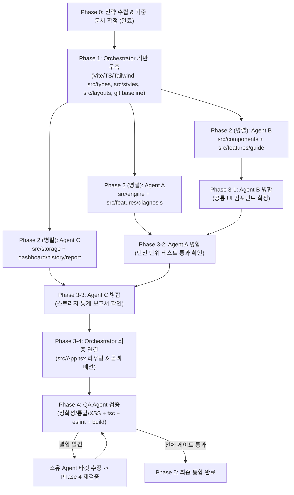

# NetDoctor — Multi-Agent 개발 전략 및 실행 계획 (`AGENT_PLAN.md`)

> **작성 기준일**: 2026-11-26  
> **프로젝트 경로**: `C:\Users\MJC\Desktop\NetDoctor`  
> **단계 목표**: Multi-Agent 역할 분담, 파일 소유권, 데이터 계약, 충돌 방지 전략, 통합 순서 및 QA 테스트 계획 확정

---

## 1. 사전 점검 결과 (현황 및 사실 기록)

### 1.1 프로젝트 문서 및 환경 점검
- **초기 워크스페이스 상태**: `C:\Users\MJC\Desktop\NetDoctor` 디렉터리가 비어 있어 필수 기준 문서 3종(`README.md`, `DESIGN.md`, `docs/DIAGNOSTIC_RULES.md`)이 누락되어 있었음.
- **보완 조치 완료**:
  - [README.md](../README.md): 프로젝트 개요, 기술 스택, 디렉터리 구조, 문서 인덱스 수립
  - [DESIGN.md](../DESIGN.md): 디자인 토큰, 5대 화면 명세, 10개 공통 컴포넌트 규격, WCAG AA 접근성 및 XSS 보안 UI 원칙 수립
  - [docs/DIAGNOSTIC_RULES.md](./DIAGNOSTIC_RULES.md): 6대 장애 유형, 4단계 진단 파이프라인, 15개 진단 규칙(`RULE-001`~`RULE-015`), 점수 체계 및 Golden Test Cases 수립
- **로컬 툴체인 확인**: `Node.js v24.22.2`, `npm 11.19.1`, `Git 2.55.0.windows.3`

### 1.2 Stitch MCP 실제 호출 및 조회 결과
- **호출 API**: `stitch.list_projects` (`view=owned`, `view=shared`)
- **실제 반환 결과**:
  - 소유 프로젝트(`view=owned`): `Travel-Planner-MVP` (`projects/15535182799094676996`), `대학생 학습관리 웹앱` (`projects/6562865603819829757`) — 총 2건
  - 공유 프로젝트(`view=shared`): 0건 (`{}`)
  - **`NetDoctor` 프로젝트**: **현재 Stitch 계정에 존재하지 않음**
- **디자인 연동 전략**:
  - 구현 전 사용자가 Stitch에 NetDoctor 프로젝트를 생성하고자 하면, Orchestrator가 `DESIGN.md`를 기반으로 Stitch MCP(`create_project`, `upload_design_md`, `generate_screen_from_text`)를 호출해 화면을 생성한 뒤 `list_screens`/`get_screen` 결과를 Agent B에 전달한다.
  - 별도 Stitch 프로젝트가 없는 상태로 즉시 구현에 진입하는 경우에도 Agent B는 [DESIGN.md](../DESIGN.md)를 SSOT로 삼아 동일한 토큰·레이아웃·컴포넌트 규격을 구현한다.

---

## 2. 병렬 Agent 실행 지원 여부 및 실제 실행 방식

### 2.1 실행 환경 사실 기록
- **실제 병렬 Agent 실행 지원 여부**: **지원함 (Supported)**
- **지원 메커니즘 (Antigravity 런타임)**:
  1. **`invoke_subagent`**: 독립된 컨텍스트를 가진 복수 Subagent를 비동기 병렬 실행 가능(`Workspace: "share"`를 통한 git worktree 수준 격리 또는 `"inherit"` 공유 워크스페이스 지원, 완료 시 부모에게 자동 알림).
  2. **`swarm`**: 공유 보드 기반 다중 워커 협업(`workspace: "share"` 지원).
  3. **`run_workflow`**: Python 스크립트 기반 `parallel` / `pipeline` 다중 에이전트 오케스트레이션 지원.

### 2.2 단계별 실제 실행 모드
- **현재 단계 (Phase 0 — 전략 수립 및 누락 문서 보완)**:
  - 코드 구현 전 설계·계약 확정 단계이므로 **Orchestrator 단독 실행**으로 문서 4종(`README.md`, `DESIGN.md`, `docs/DIAGNOSTIC_RULES.md`, `docs/AGENT_PLAN.md`)의 일관성을 단일 진실 원천으로 확정함.
- **다음 단계 (Phase 1 ~ Phase 4 — 실제 구현 및 검증)**:
  - **Phase 1 (Orchestrator 단독)**: 프로젝트 초기화(`package.json`, Vite/TS/Tailwind/ESLint/Vitest 설정), `git init` 및 기준 커밋, 공통 타입(`src/types/*`)·디자인 토큰(`src/styles/*`)·공통 레이아웃(`src/layouts/*`)·컴포넌트 스텁 인터페이스 고정.
  - **Phase 2 (실제 병렬 실행 — Parallel Fan-out)**: `Agent A`, `Agent B`, `Agent C`를 **`invoke_subagent` 3개 동시 호출**로 실제 병렬 실행한다.
    - **권장 격리 모드**: `Workspace: "share"` (각 Agent가 독립된 git working copy에서 자신의 담당 경로만 수정 -> Phase 3에서 Orchestrator가 순차 병합).
    - **보조 모드**: git 저장소 미사용 환경일 경우 `Workspace: "inherit"`로 실행하되, 섹션 4의 **상호 배타적 파일 소유권 매트릭스**를 강제하여 동일 파일 동시 수정을 원천 차단한다.
  - **Phase 3 (Orchestrator 단독)**: 병렬 산출물 병합, `src/App.tsx` 라우팅 및 Feature 간 콜백 연결, 스모크 빌드 확인.
  - **Phase 4 (QA Agent Subagent 실행)**: `QA Agent`를 별도 Subagent로 실행하여 정확성·통합·XSS 보안 테스트 작성 및 전체 품질 게이트 검증. 결함 발견 시 해당 파일 소유 Agent에게만 수정 위임 후 재검증.

---

## 3. Multi-Agent 역할 분담

### 3.1 Orchestrator (아키텍처·계약·통합 총괄)
- **책임 범위**:
  - 전체 시스템 아키텍처 설계 및 디렉터리 구조 관리
  - 공통 TypeScript 도메인 타입(`src/types/`) 및 Agent 간 데이터 계약 정의·동결
  - 공통 App Shell 레이아웃(`src/layouts/`) 및 디자인 토큰(`src/styles/tokens.css`, `src/index.css`) 작성
  - `package.json` 의존성 추가 및 버전 고정, Vite/TS/ESLint/Vitest 설정 관리
  - Phase 2 병렬 결과물 병합, `src/App.tsx` 라우팅 및 크로스-피처 콜백 연결
  - 변경 요청(CR: Change Request) 승인 및 최종 릴리스 판단

### 3.2 Agent A — 네트워크 진단 엔진
- **담당 경로**: `src/features/diagnosis/`, `src/engine/`
- **책임 기능**:
  - 장애 유형 6대 분류기(`classifySymptom`) 구현
  - 동적 질문 분기 트리(`getNextQuestion`, 최대 6단계) 구현
  - 사용자 명령어 점검 결과 처리기(`processCheckResult`) 구현
  - 15개 규칙(`RULE-001`~`RULE-015`) 기반 원인 후보 추론 및 신뢰도 계산(`evaluateDiagnosis`)
  - 판단 근거(`evidence[]`) 및 감별 추가 점검 항목(`followUpChecks[]`) 생성
  - 대화형 진단 마법사 UI(`src/features/diagnosis/`) 구현 및 결과->이력 저장 콜백 연동
  - 진단 규칙 단위 테스트(`src/engine/*.test.ts`) 작성

### 3.3 Agent B — UI 및 네트워크 가이드
- **담당 경로**: `src/features/guide/`, `src/components/`
- **책임 기능**:
  - `DESIGN.md`(및 연동 시 Stitch 화면) 기반 재사용 공통 UI 컴포넌트 10종(`src/components/`) 구현
  - OS별(Windows / macOS / Linux) 네트워크 진단 명령어 라이브러리 데이터 및 서비스(`src/features/guide/`) 구축 (`cmd-ipconfig`, `cmd-ping-loopback`, `cmd-ping-gateway`, `cmd-ping-external`, `cmd-nslookup`, `cmd-dns-flush`, `cmd-traceroute`, `cmd-port-check`, `cmd-netstat`, `cmd-arp`, `cmd-dhcp-renew`, `cmd-route-print`, `cmd-wifi-status`, `cmd-netsh-reset`, `cmd-curl-verbose` 등 15종 이상)
  - 실시간 키워드 검색 및 6대 카테고리 분류 필터
  - 원클릭 클립보드 복사 기능(`navigator.clipboard` + fallback + `aria-live` 피드백)
  - 명령어 실행 방법, 정상/비정상 출력 예시 및 결과 해석 UI
  - WCAG 2.1 AA 접근성(키보드 탐색, 대비비, ARIA 속성) 및 반응형 디자인 구현

### 3.4 Agent C — 장애 이력 및 데이터 분석
- **담당 경로**: `src/features/dashboard/`, `src/features/history/`, `src/features/report/`, `src/storage/`
- **책임 기능**:
  - 장애 이력 CRUD(`create`, `read`, `update`, `delete`, 상태 전이 `open` -> `in_progress` -> `resolved`)
  - LocalStorage 영속 저장 어댑터(`src/storage/incidentStorage.ts`) 및 손상 데이터/XSS 방어용 입력 검증·정규화
  - 장애 유형별 통계, 해결률(Resolution Rate), 평균 처리 시간(MTTR, 분 단위) 산출 엔진(`src/storage/analytics.ts`)
  - 운영 대시보드 UI(`src/features/dashboard/`): KPI 카드 4종 + 순수 SVG 장애 유형 분포 차트 + 최근 장애 목록
  - 장애 이력 관리 UI(`src/features/history/`): 다중 필터/검색, 등록·수정·삭제 모달
  - 장애 보고서 생성기(`src/features/report/`): 구조화 보고서 미리보기, 안전한 Markdown(`.md`) 및 JSON(`.json`) 다운로드, 인쇄 보기

### 3.5 QA Agent — 품질·보안·빌드 검증
- **담당 경로**: `src/test/`
- **책임 기능**:
  - 진단 엔진 정확성 검증 스위트(`src/test/diagnosis-accuracy.test.ts` — 15개 규칙 Golden Dataset 검증)
  - 핵심 사용자 여정 통합 테스트(`src/test/integration.test.tsx` — 진단 -> 이력 저장 -> 대시보드 통계 반영 -> 보고서 다운로드, 가이드 검색/복사)
  - 입력값 유효성 및 XSS 보안 검사(`src/test/security-xss.test.tsx` — `<script>`, ``, `javascript:`, `__proto__`, 초대형 문자열, 깨진 LocalStorage JSON, Markdown 인젝션 이스케이프)
  - TypeScript 타입 검사(`npx tsc --noEmit`)
  - ESLint 정적 분석(`npm run lint`)
  - Production Build 검증(`npm run build`) 및 최종 QA 리포트 발행

---

## 4. 파일 소유권 매트릭스 (File Ownership Matrix)

> **핵심 원칙**: 모든 파일은 **정확히 1개의 소유자**만 수정할 수 있습니다. 공통 파일은 **Orchestrator만 수정**하며, 타 Agent는 읽기 전용(Read-Only)으로만 참조합니다.

| 경로 / 파일 | 소유자 (Write 권한) | 참조 가능 (Read-Only) | 주요 내용 |
| :--- | :--- | :--- | :--- |
| `package.json`, `package-lock.json` | **Orchestrator** | 전체 | 의존성 및 스크립트 버전 고정 |
| `tsconfig.json`, `tsconfig.app.json`, `vite.config.ts`, `vitest.config.ts`, `eslint.config.js`, `index.html` | **Orchestrator** | 전체 | 빌드·타입·린트·테스트 설정 |
| `README.md`, `DESIGN.md`, `docs/*.md` | **Orchestrator** | 전체 | 프로젝트 기준 문서 |
| `src/main.tsx`, `src/App.tsx` | **Orchestrator** | QA Agent | 앱 엔트리포인트, 라우팅, Feature 간 연결 |
| `src/types/**` | **Orchestrator** | 전체 | 도메인 타입, 데이터 계약, 컴포넌트 Props 계약 |
| `src/styles/**`, `src/index.css` | **Orchestrator** | 전체 | CSS 디자인 토큰, 전역 스타일 |
| `src/layouts/**` | **Orchestrator** | QA Agent | `AppLayout.tsx`, 사이드바/모바일 헤더 |
| `src/engine/**` | **Agent A** | Agent A, Orchestrator, QA Agent | 규칙 엔진(`classifier.ts`, `questionTree.ts`, `rules.ts`, `evaluator.ts`, `index.ts`) 및 단위 테스트(`*.test.ts`) |
| `src/features/diagnosis/**` | **Agent A** | Orchestrator, QA Agent | 진단 마법사 페이지(`DiagnosisPage.tsx`) 및 하위 컴포넌트/훅 |
| `src/components/**` | **Agent B** | Agent A, Agent C, Orchestrator, QA Agent | 공통 UI 10종(`Button`, `Badge`, `Card`, `Modal`, `SearchInput`, `CopyCodeBlock`, `Tabs`, `ProgressBar`, `AlertBanner`, `EmptyState`, `index.ts`) |
| `src/features/guide/**` | **Agent B** | Orchestrator, QA Agent | 명령어 데이터(`commands.ts`), 검색·필터 서비스, `GuidePage.tsx` |
| `src/storage/**` | **Agent C** | Orchestrator, QA Agent | `incidentStorage.ts`, `analytics.ts`, `reportGenerator.ts`, `sanitizer.ts`, `index.ts` |
| `src/features/dashboard/**` | **Agent C** | Orchestrator, QA Agent | `DashboardPage.tsx`, KPI 카드, SVG 차트 |
| `src/features/history/**` | **Agent C** | Orchestrator, QA Agent | `HistoryPage.tsx`, CRUD 모달, 필터 바 |
| `src/features/report/**` | **Agent C** | Orchestrator, QA Agent | `ReportPage.tsx`, 보고서 미리보기·다운로드 |
| `src/test/**` | **QA Agent** | Orchestrator | `setup.ts`, `diagnosis-accuracy.test.ts`, `integration.test.tsx`, `security-xss.test.tsx` |

### 모듈 간 의존성 규칙 (Dependency Guardrails)
1. `src/engine/`(Agent A)는 **React, DOM, `src/components/`, `src/storage/`를 절대 import하지 않는다** (오직 `src/types/`만 import).
2. `src/features/diagnosis/`(Agent A)와 `src/features/history|dashboard|report/`(Agent C)는 **서로의 내부 파일을 직접 import하지 않는다**. 진단 결과를 장애 이력으로 넘기는 동작은 Orchestrator가 `src/App.tsx`에서 콜백 props(`onSaveToHistory`, `onOpenGuideCommand`)로 주입한다.
3. Agent A와 Agent C는 Phase 2 병렬 작업 중 `src/components/index.ts`를 import할 수 있도록, Phase 1에서 Orchestrator가 `src/types/contracts.ts`에 Props 타입을 고정하고 임시 최소 스텁(또는 Agent B 완료 전 타입 호환 래퍼)을 제공한다. 최종 Phase 3에서 Agent B의 완성된 `src/components/`로 교체된다.
   - *수정 권한 충돌 방지*: `src/components/` 내부 파일은 Phase 1에서 Orchestrator가 초기 생성 후 **Phase 2 시작 시 소유권을 Agent B에 단독 이관**한다. Phase 2 이후에는 Agent B만 `src/components/`를 수정한다.

---

## 5. Agent 간 데이터 계약 (Inter-Agent Data Contracts)

Phase 1에서 Orchestrator가 `src/types/`에 아래 TypeScript 인터페이스를 생성하고 동결(Freeze)합니다. 모든 Agent는 본 계약을 준수해야 합니다.

### 5.1 진단 도메인 계약 (`src/types/diagnosis.ts`)

```ts
export type FaultCategory =
  | 'PHYSICAL_LINK'
  | 'IP_DHCP'
  | 'GATEWAY_ROUTING'
  | 'DNS_RESOLUTION'
  | 'PORT_FIREWALL'
  | 'PERFORMANCE_LATENCY';

export type Severity = 'low' | 'medium' | 'high' | 'critical';

export type PrimarySymptom =
  | 'no_internet'
  | 'specific_site_fail'
  | 'slow_or_unstable'
  | 'wifi_or_cable_issue'
  | 'vpn_issue';

export type AffectedScope = 'single_device' | 'multiple_devices' | 'unknown';
export type ConnectionType = 'ethernet' | 'wifi' | 'vpn' | 'unknown';

export interface SymptomInput {
  primarySymptom: PrimarySymptom;
  affectedScope: AffectedScope;
  connectionType: ConnectionType;
  description: string;
}

export interface QuestionOption {
  value: string;
  label: string;
  description?: string;
}

export interface DiagnosticQuestion {
  id: string;
  step: number;
  prompt: string;
  helpText?: string;
  recommendedCommandId?: CommandId;
  options: QuestionOption[];
}

export interface UserAnswer {
  questionId: string;
  value: string;
  answeredAt: string; // ISO-8601
}

export type CheckType =
  | 'link_state'
  | 'ip_check'
  | 'loopback_ping'
  | 'gateway_ping'
  | 'external_ping'
  | 'dns_lookup'
  | 'port_test'
  | 'traceroute';

export type CheckStatus =
  | 'pass'
  | 'fail'
  | 'unknown'
  | 'valid_ip'
  | 'apipa_or_none'
  | 'duplicate_ip'
  | 'high_latency'
  | 'packet_loss'
  | 'alt_dns_pass'
  | 'local_hop_fail'
  | 'isp_hop_fail';

export interface VerificationCheckResult {
  checkType: CheckType;
  status: CheckStatus;
  rawNote?: string; // 사용자 메모 (렌더링 시 반드시 텍스트 이스케이프)
}

export interface FollowUpCheck {
  id: string;
  priority: 1 | 2 | 3;
  title: string;
  instruction: string;
  commandId?: CommandId;
}

export interface RootCauseCandidate {
  ruleId: string; // 'RULE-001' ~ 'RULE-015'
  category: FaultCategory;
  title: string;
  confidence: number; // 0 ~ 100 정수
  summary: string;
  evidence: string[];
  followUpChecks: FollowUpCheck[];
  recommendedCommandIds: CommandId[];
}

export interface DiagnosticResult {
  sessionId: string;
  completedAt: string; // ISO-8601
  symptom: SymptomInput;
  answers: UserAnswer[];
  checks: VerificationCheckResult[];
  primaryCategory: FaultCategory;
  suggestedSeverity: Severity;
  confidenceLevel: 'high' | 'medium' | 'low';
  candidates: RootCauseCandidate[]; // 최대 3개, confidence 내림차순
}

export interface DiagnosisEngineAPI {
  classifySymptom(input: SymptomInput): {
    initialScores: Record<FaultCategory, number>;
    firstQuestionId: string;
  };
  getNextQuestion(
    symptom: SymptomInput,
    answers: UserAnswer[],
    checks: VerificationCheckResult[]
  ): DiagnosticQuestion | null;
  processCheckResult(
    scores: Record<FaultCategory, number>,
    check: VerificationCheckResult,
    scope: AffectedScope
  ): { scores: Record<FaultCategory, number>; evidenceNote: string };
  evaluateDiagnosis(
    sessionId: string,
    symptom: SymptomInput,
    answers: UserAnswer[],
    checks: VerificationCheckResult[]
  ): DiagnosticResult;
}
```

### 5.2 명령어 가이드 계약 (`src/types/guide.ts`)

```ts
export type TargetOS = 'windows' | 'macos' | 'linux';

export type CommandCategory =
  | 'CONNECTIVITY'
  | 'DNS'
  | 'ROUTING'
  | 'PORT_FIREWALL'
  | 'IP_DHCP'
  | 'WIFI_NIC';

export type CommandId =
  | 'cmd-ipconfig'
  | 'cmd-ping-loopback'
  | 'cmd-ping-gateway'
  | 'cmd-ping-external'
  | 'cmd-nslookup'
  | 'cmd-dns-flush'
  | 'cmd-traceroute'
  | 'cmd-port-check'
  | 'cmd-netstat'
  | 'cmd-arp'
  | 'cmd-dhcp-renew'
  | 'cmd-route-print'
  | 'cmd-wifi-status'
  | 'cmd-netsh-reset'
  | 'cmd-curl-verbose';

export interface CommandVariant {
  os: TargetOS;
  syntax: string;
  requiresAdmin?: boolean;
  notes?: string;
}

export interface OutputInterpretation {
  status: 'normal' | 'warning' | 'error';
  pattern: string;
  meaning: string;
  nextAction: string;
}

export interface NetworkCommand {
  id: CommandId;
  name: string;
  category: CommandCategory;
  relatedFaultCategories: FaultCategory[];
  summary: string;
  variants: Record<TargetOS, CommandVariant>;
  executionSteps: string[];
  sampleOutput: string;
  interpretations: OutputInterpretation[];
  tags: string[];
}

export interface GuideFilter {
  query: string;
  category: CommandCategory | 'ALL';
  os: TargetOS;
}
```

### 5.3 장애 이력·통계·보고서 계약 (`src/types/incident.ts`)

```ts
export type IncidentStatus = 'open' | 'in_progress' | 'resolved';

export interface IncidentRecord {
  id: string; // UUID 또는 'INC-YYYYMMDD-XXXX'
  title: string;
  category: FaultCategory;
  severity: Severity;
  status: IncidentStatus;
  symptomSummary: string;
  rootCauseSummary: string;
  resolutionNotes: string;
  affectedScope: AffectedScope;
  relatedRuleId?: string;
  confidence?: number;
  recommendedCommandIds: CommandId[];
  createdAt: string; // ISO-8601
  updatedAt: string; // ISO-8601
  resolvedAt?: string; // ISO-8601 (status === 'resolved'일 때 기록)
  resolutionTimeMinutes?: number; // resolvedAt - createdAt (최소 1분 또는 0 이상 정수)
  diagnosticSnapshot?: DiagnosticResult;
}

export type IncidentCreateInput = Omit<
  IncidentRecord,
  'id' | 'createdAt' | 'updatedAt' | 'resolutionTimeMinutes'
>;

export type IncidentUpdateInput = Partial<
  Omit<IncidentRecord, 'id' | 'createdAt'>
>;

export interface IncidentFilter {
  query?: string;
  status?: IncidentStatus | 'ALL';
  category?: FaultCategory | 'ALL';
  severity?: Severity | 'ALL';
}

export interface CategoryStat {
  category: FaultCategory;
  count: number;
  resolvedCount: number;
  percentage: number; // 0 ~ 100
}

export interface DashboardMetrics {
  totalIncidents: number;
  openCount: number;
  inProgressCount: number;
  resolvedCount: number;
  resolutionRate: number; // 0 ~ 100 (소수점 1자리)
  averageResolutionMinutes: number; // 해결 건 기준 평균 MTTR (해결 건 0이면 0)
  byCategory: CategoryStat[];
  recentIncidents: IncidentRecord[]; // 최신 5건
}

export interface IncidentStorageAPI {
  list(filter?: IncidentFilter): IncidentRecord[];
  getById(id: string): IncidentRecord | null;
  create(input: IncidentCreateInput): IncidentRecord;
  update(id: string, patch: IncidentUpdateInput): IncidentRecord | null;
  remove(id: string): boolean;
  clearAll(): void;
}
```

### 5.4 크로스-피처 통합 및 LocalStorage 스키마 계약 (`src/types/contracts.ts`)

- **Feature Page Props 계약 (Orchestrator가 `src/App.tsx`에서 주입)**:
  - `DiagnosisPageProps`:
    - `onSaveIncident: (draft: IncidentCreateInput) => IncidentRecord`
    - `onInspectCommand: (commandId: CommandId) => void`
  - `GuidePageProps`:
    - `initialCommandId?: CommandId`
  - `DashboardPageProps`:
    - `incidents: IncidentRecord[]`
    - `onStartDiagnosis: () => void`
    - `onSelectIncident: (incidentId: string) => void`
  - `HistoryPageProps`:
    - `incidents: IncidentRecord[]`
    - `onCreate: (input: IncidentCreateInput) => void`
    - `onUpdate: (id: string, patch: IncidentUpdateInput) => void`
    - `onDelete: (id: string) => void`
    - `onOpenReport: (incidentId: string) => void`
  - `ReportPageProps`:
    - `incidents: IncidentRecord[]`
    - `initialIncidentId?: string`
- **LocalStorage 키 규격**:
  - `netdoctor:incidents:v1`: `IncidentRecord[]` 직렬화 JSON
  - 파싱 실패, 배열이 아닌 값, 필수 필드 누락 레코드 발견 시 예외를 던지지 않고 유효한 항목만 복구하거나 안전하게 빈 배열(`[]`)로 폴백한다.

---

## 6. 충돌 방지 전략 (Conflict Prevention Strategy)

| # | 전략 | 구체적 실행 규칙 |
| :-: | :--- | :--- |
| 1 | **물리적 경로 격리 (Zero Overlap)** | 섹션 4 매트릭스 기준, 병렬 실행되는 Agent A / B / C의 쓰기 경로 교집합은 **공집합(`∅`)**으로 유지한다. |
| 2 | **계약 우선 동결 (Contract-First Freeze)** | Phase 2 병렬 착수 전에 Orchestrator가 `package.json`, `tsconfig.json`, `src/types/**`, `src/styles/**`, `src/layouts/**`를 먼저 커밋하고 동결한다. |
| 3 | **독립 워크트리 병렬 실행 (`workspace: "share"`)** | 병렬 Subagent 실행 시 각 Agent를 별도 브랜치/워크트리(`feat/agent-a-diagnosis`, `feat/agent-b-ui-guide`, `feat/agent-c-history-analytics`)에서 실행하여 파일 시스템 경합을 원천 차단한다. |
| 4 | **변경 요청 프로토콜 (CR Protocol)** | 작업 중 신규 npm 패키지, 공통 타입 필드 추가, 디자인 토큰 변경이 필요하면 Agent는 공통 파일을 직접 수정하지 않고 Orchestrator에게 `[CHANGE_REQUEST]`를 반환한다. Orchestrator가 검토·반영 후 동기화한다. |
| 5 | **배럴 파일 경계 준수** | 각 Agent는 자신의 디렉터리 내부 `index.ts`만 작성하며, 상위 라우터(`src/App.tsx`)와 진입점(`src/main.tsx`)은 Orchestrator만 수정한다. |
| 6 | **자동 소유권 diff 검증** | Orchestrator는 각 Agent 결과물을 병합하기 전에 `git diff --name-only`로 허용된 디렉터리 외부 파일 수정이 0건인지 검사한다. 위반 파일이 있으면 병합을 거부한다. |

---

## 7. 통합 순서 및 단계별 완료 기준 (Integration Sequence)



### 단계별 진입/완료 기준 (Definition of Done)

1. **Phase 1 — Orchestrator Foundation**
   - 완료 기준: `npm install` 완료, `src/types/**` & `src/styles/tokens.css` & `src/layouts/AppLayout.tsx` 작성, `src/components/index.ts` 초기 스텁 배치, `npx tsc --noEmit` 통과, `git commit` 기준점 생성.
2. **Phase 2 — Parallel Feature Implementation (Agent A || Agent B || Agent C)**
   - **Agent A 완료 기준**: 15개 규칙 구현, 동적 질문 분기 및 점검 처리 완료, `src/engine/*.test.ts` 전체 통과, `DiagnosisPage` 완성.
   - **Agent B 완료 기준**: 공통 컴포넌트 10종 완성, 15종 이상 OS별 명령어 가이드·검색·복사·결과 해석 완성, 키보드 접근성 및 반응형 검증.
   - **Agent C 완료 기준**: LocalStorage CRUD + 손상 복구 + XSS 안전화 유틸, KPI/SVG 대시보드, 이력 관리 UI, Markdown/JSON 보고서 다운로드 완성.
3. **Phase 3 — Orchestrator Integration**
   - 병합 순서(의존성 역순): **① Agent B (`src/components/`, `src/features/guide/`) -> ② Agent A (`src/engine/`, `src/features/diagnosis/`) -> ③ Agent C (`src/storage/`, `dashboard`, `history`, `report`) -> ④ `src/App.tsx` 통합 배선**.
   - 완료 기준: 모든 라우트(`/dashboard`, `/diagnosis`, `/guide`, `/history`, `/report`) 연결, 진단->이력 저장->보고서 이동 플로우 정상 동작, `npx tsc --noEmit` 통과.
4. **Phase 4 — QA Agent Verification**
   - 완료 기준: 섹션 8의 모든 테스트 및 정적/빌드 게이트 100% 통과.

---

## 8. QA 테스트 및 품질·보안 검증 계획 (`src/test/`)

### 8.1 테스트 스위트 구성

| 테스트 파일 | 담당 | 검증 목표 | 세부 항목 |
| :--- | :---: | :--- | :--- |
| `src/engine/*.test.ts` | **Agent A** | 진단 엔진 단위 테스트 | `classifySymptom`, `getNextQuestion`, `processCheckResult`, `evaluateDiagnosis` 순수 함수 동작 및 15개 규칙 개별 검증 |
| `src/test/diagnosis-accuracy.test.ts` | **QA Agent** | 진단 엔진 정확성 검증 | `docs/DIAGNOSTIC_RULES.md` 10개 핵심 Golden Case + 15개 전 규칙 매핑 정확도, 신뢰도 범위(`0~100`), 경합 원인 감별 점검 생성, `unknown` 다수 입력 시 폴백 안정성 |
| `src/test/integration.test.tsx` | **QA Agent** | 핵심 기능 통합 테스트 | ① 진단 마법사 완료 -> "장애 이력으로 저장" 클릭 -> 이력 목록 반영 -> 대시보드 KPI(총 건수·해결률·MTTR) 갱신 -> 보고서 미리보기·다운로드 트리거<br>② 명령어 가이드 검색·카테고리 필터·OS 전환·클립보드 복사 피드백<br>③ 장애 이력 생성·상태 변경(`resolved` 시 MTTR 자동 산출)·수정·삭제 및 LocalStorage 재로드 영속성 |
| `src/test/security-xss.test.tsx` | **QA Agent** | 입력값 유효성 및 XSS 보안 검사 | ① `<script>alert('xss')</script>`, ``, `javascript:alert(1)` 입력 시 DOM 스크립트 미실행 및 텍스트 이스케이프 렌더링 확인<br>② `__proto__`, `constructor`, `prototype` 키 및 10,000자 초대형 입력 방어<br>③ 손상된 LocalStorage JSON(`"{broken"`, `null`, 잘못된 타입) 로드 시 크래시 없이 안전 복구<br>④ 보고서 Markdown 내보내기 시 HTML 태그/링크 프로토콜 무력화 확인<br>⑤ 코드베이스 내 `dangerouslySetInnerHTML`, `eval`, `new Function`, `innerHTML` 미사용 검증 |

### 8.2 필수 품질 게이트 (Release Gate Criteria)

모든 게이트는 **0 Error**를 만족해야 최종 완료로 승인합니다.

| 순서 | 검증 항목 | 실행 명령어 | 통과 기준 |
| :-: | :--- | :--- | :--- |
| 1 | **TypeScript 정적 타입 검사** | `npx tsc --noEmit` | 오류 0건 (`strict: true`, `noUnusedLocals`, `noUnusedParameters`) |
| 2 | **ESLint 코드 품질 검사** | `npm run lint` | 오류 0건, 치명적 경고 0건 |
| 3 | **단위·정확성·통합·보안 테스트** | `npm run test -- --run` | 전체 테스트 100% 통과 (`src/engine/` 커버리지 >= 90%, `src/storage/` >= 85% 권장) |
| 4 | **Production Build 검증** | `npm run build` | Vite 프로덕션 번들 성공, `dist/` 산출물 정상 생성 |

---

## 9. 다음 구현 단계 착수 체크리스트

다음 프롬프트(구현 단계) 시작 시 아래 순서로 즉시 실행합니다.

1. **(선택) Stitch 디자인 생성 여부 확인**: 사용자가 Stitch MCP로 NetDoctor 디자인 화면 생성을 원하면 `stitch.create_project` -> `upload_design_md` -> `generate_screen_from_text` 실행 후 진행.
2. **Phase 1 실행 (Orchestrator)**: Vite + React + TypeScript + Tailwind + Vitest 스캐폴딩, `git init` 및 공통 계약 파일(`src/types/*`, `src/styles/tokens.css`, `src/layouts/AppLayout.tsx`) 커밋.
3. **Phase 2 실행 (실제 병렬 Subagent 3개 동시 호출)**: Agent A, Agent B, Agent C 동시 투입(`workspace: "share"`).
4. **Phase 3 실행 (Orchestrator)**: 소유권 diff 검증 -> B -> A -> C 순차 병합 -> `src/App.tsx` 통합 연결.
5. **Phase 4 실행 (QA Agent)**: 테스트 스위트 작성 및 4대 품질 게이트(`tsc`, `lint`, `test`, `build`) 통과 확인.
